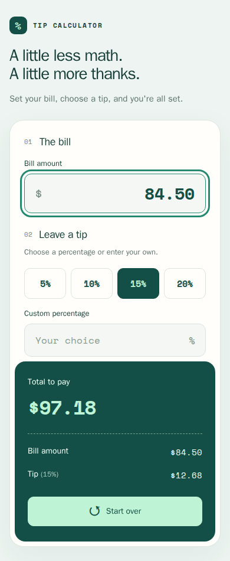
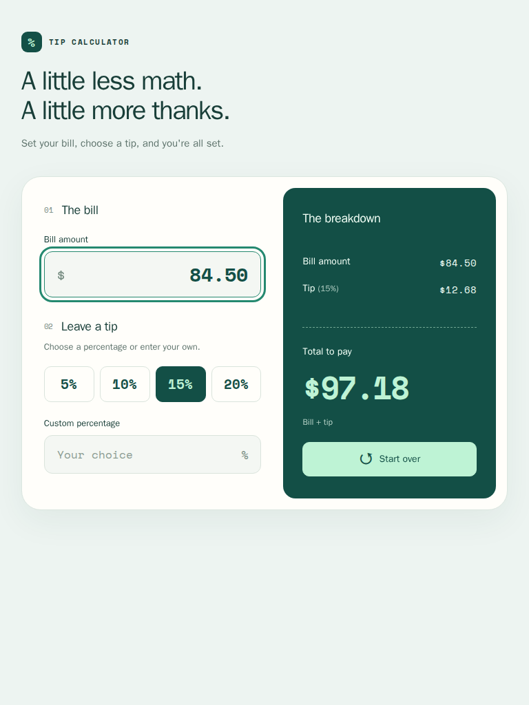
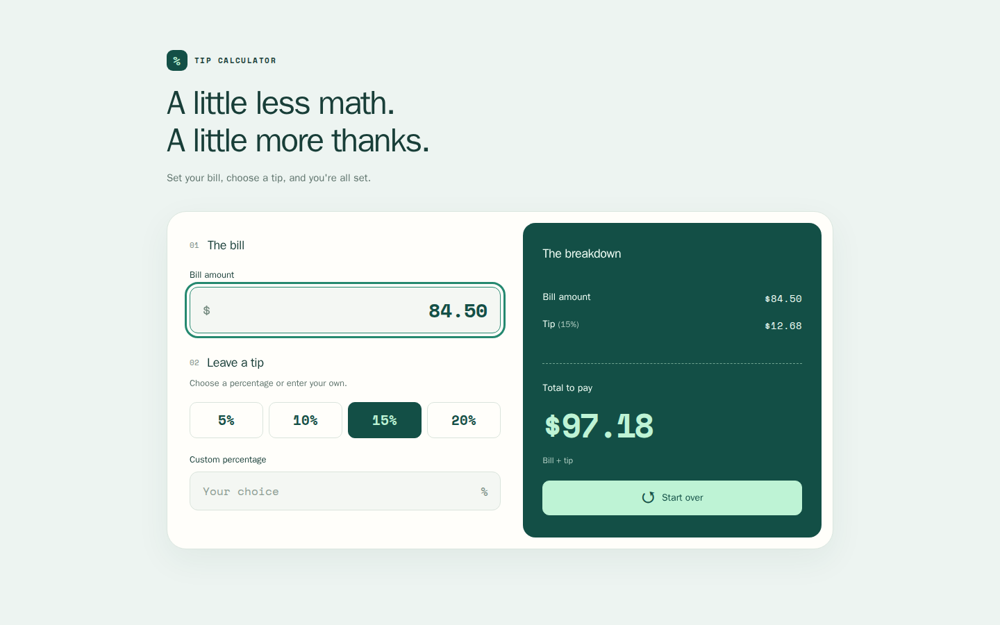

# Tip Calculator
A responsive tip calculator built with HTML, CSS, JavaScript, and jQuery. Choose a preset or custom percentage to see the bill, rounded tip, and total.

[Open Tip Calculator](https://jaimegonzalezjr.com/Projects/tips/)

The layout stacks on phones and places the controls beside the breakdown on tablets and desktops. Inputs support decimal keyboards, visible keyboard focus, and validation for negative values and excess decimal places.

## Screenshots

### Phone

### Tablet

### Desktop

## Local preview and tests

Serve this directory with a static server, for example `python3 -m http.server 4173`, then open `http://localhost:4173`.

Run the calculation regression tests with `npm test`. No package installation is needed for these tests.

Browser checks require Playwright and its Chromium browser. With Playwright installed, run `npm run test:browser` while the preview server is running. Set `TIP_TEST_URL` to check another URL. These checks exercise the calculator at six viewport sizes, including phone landscape, and verify layout, touch target sizes, keyboard activation, validation, selection, and reset behavior.
